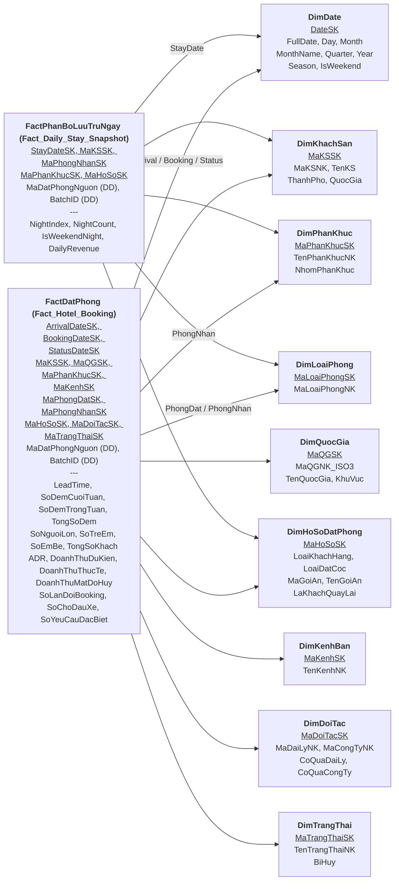
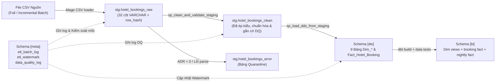

# BÁO CÁO GIAI ĐOẠN 1: KHÁM PHÁ BÀI TOÁN, DATA PROFILING & THIẾT KẾ DATA WAREHOUSE (HOTEL BOOKING DEMAND)

> **Tài liệu tham chiếu:** [2627.Yêu cầu_unlocked.pdf](../docs/requirements/2627.%20Y%C3%AAu%20c%E1%BA%A7u_unlocked.pdf)
> **Công cụ tích hợp dữ liệu (ETL):** Đường chạy chính dùng **Mage.ai** nạp dữ liệu vào **SQL Server**; **dbt** dựng lớp BI mart và kiểm tra dữ liệu. Project cũng giữ bộ package **SSIS** như một phương án thay thế.

---

## I. GIỚI THIỆU BỐI CẢNH, CÔNG TY LƯU TRỮ & MÔ TẢ DATASET

### 1.1. Nguồn dữ liệu & Công ty lưu trữ
- **Tên bộ dữ liệu:** Hotel Booking Demand
- **Đường dẫn Kaggle:** `https://www.kaggle.com/datasets/jessemostipak/hotel-booking-demand`
- **Công bố khoa học gốc:** Nuno António, Ana de Almeida, Luís Nunes (2019), *"Hotel booking demand datasets"*, tạp chí *Data in Brief* (Elsevier), Vol. 22, trang 41–49.
- **Công ty / Đơn vị lưu trữ dữ liệu:**
  Dữ liệu được trích xuất trực tiếp từ cơ sở dữ liệu của hệ thống **PMS (Property Management System)** thuộc một tập đoàn vận hành **hai khách sạn thực tế tại Bồ Đào Nha** (tên thương hiệu và thông tin định danh cá nhân PII của khách hàng đã được ẩn danh để tuân thủ GDPR):
  1. **Resort Hotel (`H1`):** Khách sạn nghỉ dưỡng 4–5 sao tọa lạc tại vùng biển **Algarve** (miền Nam Bồ Đào Nha) — gồm **`40,060` giao dịch đặt phòng** (`33.55%`). Đặc thù khách lưu trú dài ngày, đi theo gia đình/nhóm du lịch và biến động rất mạnh theo mùa cao điểm hè.
  2. **City Hotel (`H2`):** Khách sạn đô thị tọa lạc tại trung tâm thủ đô **Lisbon** (Bồ Đào Nha) — gồm **`79,330` giao dịch đặt phòng** (`66.45%`). Đặc thù phục vụ khách công tác, hội nghị (MICE), khách lẻ du lịch thành phố ngắn ngày với nhu cầu ổn định hơn quanh năm.

### 1.2. Quy mô & Mô tả sơ lược 32 thuộc tính của Dataset
- **Quy mô:** **`119,390` bản ghi** × **`32` cột**, ghi nhận các đơn đặt phòng có ngày đến dự kiến (`arrival_date`) từ **01/07/2015 đến 31/08/2017**.
- **Phân nhóm 32 thuộc tính nguồn ([hotel_bookings.csv](../data/raw/hotel_bookings.csv)):**

| Nhóm thông tin | Các cột thuộc tính trong Dataset | Ý nghĩa nghiệp vụ sơ lược |
| :--- | :--- | :--- |
| **1. Khách sạn & Thời gian** (7 cột) | `hotel`, `lead_time`, `arrival_date_year`, `arrival_date_month`, `arrival_date_week_number`, `arrival_date_day_of_month`, `days_in_waiting_list` | Loại khách sạn (`Resort Hotel`/`City Hotel`), số ngày đặt trước (`lead_time`), ngày/tuần/tháng/năm nhận phòng dự kiến và số ngày nằm trong danh sách chờ xác nhận. |
| **2. Thời lượng lưu trú & Số khách** (5 cột) | `stays_in_weekend_nights`, `stays_in_week_nights`, `adults`, `children`, `babies` | Số đêm nghỉ cuối tuần (Thứ 7, CN), số đêm nghỉ trong tuần (Thứ 2 – Thứ 6), số lượng người lớn, trẻ em và em bé đi cùng. |
| **3. Khách hàng, Kênh bán & Đối tác** (7 cột) | `country`, `market_segment`, `distribution_channel`, `customer_type`, `is_repeated_guest`, `agent`, `company` | Quốc tịch khách (mã ISO-3), phân khúc thị trường (`Online TA`, `Groups`, `Direct`...), kênh phân phối (`TA/TO`, `Direct`, `Corporate`, `GDS`), loại khách, cờ khách quay lại, mã đại lý (`agent`) và mã công ty (`company`). |
| **4. Phòng, Dịch vụ & Giá** (6 cột) | `reserved_room_type`, `assigned_room_type`, `meal`, `adr`, `required_car_parking_spaces`, `total_of_special_requests` | Mã hạng phòng khách đặt (`A`–`P`), mã hạng phòng thực tế khách sạn giao, gói bữa ăn (`BB`, `HB`, `FB`, `SC`), giá phòng bình quân mỗi đêm (`adr` - Average Daily Rate), số chỗ đậu xe và số yêu cầu đặc biệt. |
| **5. Trạng thái, Đặt cọc & Lịch sử** (7 cột) | `is_canceled`, `reservation_status`, `reservation_status_date`, `deposit_type`, `booking_changes`, `previous_cancellations`, `previous_bookings_not_canceled` | Cờ hủy phòng (`0`/`1`), trạng thái cuối (`Check-Out`, `Canceled`, `No-Show`), ngày cập nhật trạng thái cuối, loại đặt cọc (`No Deposit`, `Non Refund`, `Refundable`), số lần sửa đổi booking và lịch sử hủy trước đó của khách. |

### 1.3. Bối cảnh nghiệp vụ, Đối tượng sử dụng & Mục tiêu phân tích BI
- **Bối cảnh bài toán:** Cả hai khách sạn có **`43,017` đơn Canceled (`36.03%`)** và **`1,207` đơn No-Show (`1.01%`)**; gộp hai trạng thái là `44,224` đơn (`37.04%`). Giá trị `ADR × số đêm` của các đơn này được dùng như **doanh thu ước tính có rủi ro**, không khẳng định là khoản thất thu thực tế vì dữ liệu không cho biết khả năng bán lại phòng hoặc mức phí hủy đã thu. Ngoài ra, việc phụ thuộc vào kênh đại lý trực tuyến (`Online TA` chiếm `47.3%` tổng đặt phòng) và tình trạng phải đổi hạng phòng khi khách đến (`12.49%` số đơn) đòi hỏi một hệ thống Business Intelligence tập trung.
- **Đối tượng sử dụng:**
  - **Ban Giám đốc (General Managers):** Theo dõi KPI tổng quan (Doanh thu thực nhận, doanh thu ước tính có rủi ro từ đơn hủy/No-Show, Công suất đêm phòng, ADR) giữa Resort Hotel và City Hotel.
  - **Bộ phận Quản lý Doanh thu (Revenue Management):** Phân tích chính sách giá (`ADR`), thời gian đặt trước (`lead_time`), chính sách đặt cọc (`deposit_type`) và bài toán phân bổ doanh thu theo từng ngày/mùa.
  - **Bộ phận Kinh doanh & Vận hành (Sales & Operations):** Đánh giá hiệu quả từng kênh phân phối, đại lý (`agent`), thị trường khách (`country`), nhu cầu bữa ăn/đậu xe và tỷ lệ đổi phòng.

---

## II. DATA PROFILING: CÁC TÌNH HUỐNG CẦN XỬ LÝ KHI ĐƯA VÀO DW

Kết quả chạy script [data_profiling.py](../scripts/data_profiling.py) trực tiếp trên `119,390` bản ghi của file `data/raw/hotel_bookings.csv` cho thấy **9 tình huống dữ liệu thực tế** cần xử lý trong pipeline ETL:

### 2.1. Bảng tổng hợp các tình huống xử lý dữ liệu (Data Quality & Profiling Matrix)

| STT | Tình huống dữ liệu (Data Issue) | Số liệu Profiling thực tế trên 119,390 dòng | Nguyên nhân / Bản chất nghiệp vụ | Phương án xử lý khi đưa vào Staging & DW (Mage / SQL / dbt) |
| :--- | :--- | :--- | :--- | :--- |
| **1** | **Thiếu khóa chính tự nhiên (`booking_id`) & Bản ghi trùng lặp hoàn toàn** | - Không có cột ID giao dịch. - Có **`31,994` dòng trùng lặp hoàn toàn** trên cả 32 cột (`26.80%`), còn **`87,396` dòng duy nhất**. | Do dữ liệu đã xóa PII của khách. Các dòng giống hệt nhau có thể là khách đoàn (`Group`/`Transient-Party`) hoặc đại lý đặt nhiều phòng cùng lúc với thông số y hệt. | - **Không xóa `DISTINCT` mù quáng** để tránh làm lệch tổng số phòng và doanh thu. - Sinh khóa kỹ thuật `staging_row_id` làm `MaDatPhongNguon` (Degenerate Dimension). - Tính `row_hash` (SHA-256 trên 32 cột) và gắn cờ `is_exact_duplicate = 1` (cho 31,994 dòng) để người dùng Power BI có bộ lọc chuyển đổi linh hoạt. |
| **2** | **Chuỗi `'NA'` và `'NULL'` không đồng nhất trong các cột thiếu dữ liệu** | - `children`: **`4` dòng** lưu chuỗi `'NA'` (`0.003%`). - `country`: **`488` dòng** lưu chuỗi `'NULL'` (`0.409%`). - `agent`: **`16,340` dòng** lưu chuỗi `'NULL'` (`13.686%`). - `company`: **`112,593` dòng** lưu chuỗi `'NULL'` (`94.307%`). | Khi xuất từ PMS ra CSV, giá trị rỗng ở cột `children` được ghi là `'NA'`, còn ở `country`, `agent`, `company` lại ghi thành chuỗi chữ `'NULL'`. Nếu nạp trực tiếp vào cột số mà chưa chuẩn hóa thì sẽ lỗi ép kiểu. | - Bảng `stg.hotel_bookings_raw` dùng kiểu `VARCHAR` cho toàn bộ cột. - Trong bước Clean: kiểm tra `IN ('NA', 'NULL', '')`:   + `children` $\rightarrow$ gán `0` (kiểu `INT`).   + `country` $\rightarrow$ gán `'UNK'` (Unknown).   + `agent`, `company` $\rightarrow$ gán `'0'` (đại diện cho *Đặt trực tiếp / Không qua đại lý hoặc công ty*). |
| **3** | **Giá trị `'Undefined'` trong các cột phân loại** | - `meal`: **`1,169` dòng** `'Undefined'` (`0.979%`), bên cạnh `10,650` dòng `'SC'`. - `market_segment`: **`2` dòng** `'Undefined'` (`0.002%`). - `distribution_channel`: **`5` dòng** `'Undefined'` (`0.004%`). | Theo bài báo gốc của António et al., trong cột `meal`, cả `'Undefined'` và `'SC'` (Self Catering) đều mang nghĩa **khách không đặt gói ăn**. Ở 2 cột kênh bán là thiếu thông tin phân loại. | - Cột `meal`: Chuẩn hóa `'Undefined'` $\rightarrow$ `'SC'` (`Self Catering / No Meal Package`). - Cột `market_segment` và `distribution_channel`: Chuẩn hóa `'Undefined'` $\rightarrow$ `'Unknown'` để map vào phần tử Unknown trong bảng Dimension. |
| **4** | **Giá phòng bình quân (`ADR`) bị âm (Data Error)** | - Có **`1` dòng `ADR < 0`**: Dòng thứ `14,970` có `adr = -6.38` (`Resort Hotel`, trạng thái `Check-Out`). | Lỗi nhập liệu hoặc điều chỉnh bút toán hoàn tiền sai trên PMS (giá phòng không thể âm). | - Cô lập (Quarantine) dòng này sang bảng lỗi `stg.hotel_bookings_error` với mã `ERR_NEGATIVE_ADR`. - Ghi nhận vào `meta.data_quality_log` và **không nạp vào bảng Fact**. |
| **5** | **Giá phòng `ADR` ngoại lai cực đại (Extreme Outlier) & `ADR = 0`** | - `Min = -6.38`, `Max = 5400.00`, `Mean = 101.83`, `Median = 94.58`. - Có **`1` dòng `ADR = 5400.00`** (dòng `48,516`, `City Hotel`, trạng thái `Canceled`). - Có **`1,959` dòng `ADR = 0`** (`1.64%`). | - Dòng `5400.00` gấp ~53 lần mức trung bình (khả năng gõ nhầm từ `54.00`), làm lệch trung bình `AVG(ADR)`. - Các dòng `ADR = 0` là phòng miễn phí (`Complementary`) hoặc khuyến mãi. | - Giữ lại dòng `ADR = 5400.00` (để không mất lịch sử hủy phòng) nhưng gắn cờ `is_adr_outlier = 1` để loại trừ khi tính ADR bình quân. - Giữ nguyên các dòng `ADR = 0` vì hợp lệ về mặt nghiệp vụ. |
| **6** | **Đặt phòng có tổng số khách bằng 0 (`Zero Guests`)** | - Có **`180` dòng** có `adults + children + babies = 0`. | Đơn đặt giữ chỗ ảo, lỗi nhập liệu hoặc hủy/đóng phòng kỹ thuật trên PMS. | - Gắn cờ `is_zero_guest = 1` trong Staging & Fact. - Ghi cảnh báo `WARN_ZERO_GUESTS` vào bảng `meta.data_quality_log`. |
| **7** | **Phòng chỉ có trẻ em/em bé (`adults = 0` & `kids > 0`) & Số khách cực đại** | - Có **`223` dòng** có `adults = 0` nhưng `children > 0` hoặc `babies > 0`. - Giá trị lớn nhất: `max(adults) = 55` (dòng `2174`), `max(children) = 10` (dòng `329`), `max(babies) = 10` (dòng `46620`). | - 223 dòng `adults = 0` thường là gia đình đặt thêm phòng phụ cạnh nhau cho trẻ em. - Các dòng 40–55 người lớn là đặt đoàn (`Group`) nhưng đều đã bị `Canceled`. | - Giữ nguyên bản ghi để bảo toàn thống kê đặt phòng, ghi nhận cảnh báo vào `meta.data_quality_log`. |
| **8** | **Tổng số đêm lưu trú bằng 0 (`total_nights = 0`)** | - Có **`715` dòng** có `stays_in_weekend_nights + stays_in_week_nights = 0` (trong đó **`680` dòng** có trạng thái `Check-Out`). | Khách sử dụng phòng trong ngày (**Day-use**: nhận phòng buổi sáng và trả phòng buổi chiều cùng ngày). | - Hợp lệ về nghiệp vụ. - Khi tính doanh thu theo đêm: `DoanhThu = ADR * TongSoDem = 0`. - Khi viết công thức chia cho số đêm phải dùng `NULLIF(TongSoDem, 0)` hoặc `DIVIDE(..., ..., 0)` để tránh lỗi chia cho 0. |
| **9** | **Tách rời thành phần ngày nhận phòng & Khác biệt hạng phòng** | - Ngày nhận phòng bị tách thành 3 cột: `arrival_date_year` (số), `arrival_date_month` (tên tháng tiếng Anh `"July"`), `arrival_date_day_of_month` (số). (`0` dòng lỗi ngày). - Có **`14,917` dòng (`12.49%`)** có `reserved_room_type <> assigned_room_type`. | - Cấu trúc xuất báo cáo của PMS tách rời năm/tháng/ngày. - Khách sạn nâng hạng phòng (upgrade) hoặc điều chuyển phòng khi hết hạng phòng khách đặt. | - Ghép 3 cột thành kiểu `DATE` chuẩn (`arrival_date`). - Tính thêm ngày đặt phòng: `booking_date = DATEADD(DAY, -lead_time, arrival_date)`. - Thiết kế Role-playing Dimension cho cả phòng đặt (`MaPhongDatSK`) và phòng nhận (`MaPhongNhanSK`), kèm cờ `is_room_changed`. |

### 2.2. Thống kê phân bố các thuộc tính phân loại (Kiểm chứng từ Dataset)
- **Khách sạn (`hotel`):** `City Hotel`: `79,330` (`66.45%`) | `Resort Hotel`: `40,060` (`33.55%`).
- **Trạng thái (`is_canceled` & `reservation_status`):** Khớp 100% không có mâu thuẫn:
  - `is_canceled = 0` $\rightarrow$ `Check-Out`: `75,166` dòng (`62.96%`).
  - `is_canceled = 1` $\rightarrow$ `Canceled`: `43,017` dòng (`36.03%`) và `No-Show`: `1,207` dòng (`1.01%`).
- **Gói ăn (`meal`):** `BB`: `92,310` | `HB`: `14,463` | `SC`: `10,650` | `Undefined`: `1,169` (gộp vào `SC` thành `11,819`) | `FB`: `798`.
- **Phân khúc (`market_segment`):** `Online TA`: `56,477` | `Offline TA/TO`: `24,219` | `Groups`: `19,811` | `Direct`: `12,606` | `Corporate`: `5,295` | `Complementary`: `743` | `Aviation`: `237` | `Undefined`: `2`.
- **Kênh phân phối (`distribution_channel`):** `TA/TO`: `97,870` | `Direct`: `14,645` | `Corporate`: `6,677` | `GDS`: `193` | `Undefined`: `5`.
- **Loại đặt cọc (`deposit_type`):** `No Deposit`: `104,641` | `Non Refund`: `14,587` | `Refundable`: `162`.
- **Loại khách (`customer_type`):** `Transient`: `89,613` | `Transient-Party`: `25,124` | `Contract`: `4,076` | `Group`: `577`.

---

## III. THIẾT KẾ MÔ HÌNH DỮ LIỆU ĐA CHIỀU — DDS

### 1. Xác định Business Process / Business Event
**Sự kiện đặt phòng và lưu trú của chuỗi khách sạn:** Mỗi giao dịch đặt phòng phát sinh khi một khách hàng (cá nhân, nhóm hoặc hợp đồng) đặt một hạng phòng với gói bữa ăn và chính sách đặt cọc cụ thể, thông qua một kênh phân phối / đại lý cụ thể, tại một chi nhánh khách sạn (`Resort Hotel` hoặc `City Hotel`), cho một kỳ lưu trú xác định và kết thúc ở một trạng thái cuối cùng (`Check-Out`, `Canceled` hoặc `No-Show`).

- **Nguồn:** Hệ thống PMS khách sạn $\rightarrow$ Bảng giao dịch đặt phòng (`hotel_bookings.csv`).

---

### 2. Xác định mức chi tiết của dữ kiện – Grain
- **Bảng Fact chính (`FactDatPhong` / `Fact_Hotel_Booking`):**
  Một dòng trong bảng fact tương ứng với **một dòng giao dịch đặt phòng (`booking record`)** trong dữ liệu nguồn (`~ 1 đơn đặt phòng cho 1 kỳ lưu trú tại 1 khách sạn`).
  - *Ví dụ:* Đơn đặt phòng tại `Resort Hotel`, nhận phòng ngày `01/07/2015`, khách từ Bồ Đào Nha (`PRT`) đặt phòng hạng `A` qua kênh `Direct` cho `2` người lớn, lưu trú `2` đêm cuối tuần và `3` đêm trong tuần (`5` đêm) với giá `ADR = 110 EUR/đêm`, trạng thái `Check-Out` $\rightarrow$ tạo thành **1 dòng** trong `FactDatPhong`.
- **Bảng Fact bổ trợ phân bổ (`FactPhanBoLuuTruNgay` / `Fact_Daily_Stay_Snapshot`):**
  Một dòng trong bảng fact phân bổ tương ứng với **1 đêm lưu trú thực tế được sinh ra từ 1 đơn đặt phòng** (phục vụ bài toán phân bổ doanh thu và tính công suất phòng chính xác theo từng ngày lịch — xem chi tiết tại Mục 6 bên dưới).

---

### 3. Xác định các bảng Dimension & Degenerate Dimension

1. **DimDate** (<u>**DateSK**</u>, FullDate, Day, DayOfWeek, DayName, IsWeekend, WeekOfYear, Month, MonthName, Quarter, Year, Season)
   - *Role-playing Dimension đóng 3 vai trò trên bảng Fact:* Ngày nhận phòng (`ArrivalDateSK`), Ngày đặt phòng (`BookingDateSK`), Ngày cập nhật trạng thái (`StatusDateSK`).
   - `IsWeekend` `{0: Ngày trong tuần, 1: Ngày cuối tuần}`
   - `Season` `{Spring, Summer, Autumn, Winter}`
   - **Phân cấp:**
     - `Date` $\rightarrow$ `Month` $\rightarrow$ `Quarter` $\rightarrow$ `Year`
     - `Date` $\rightarrow$ `WeekOfYear` $\rightarrow$ `Year`
     - `Date` $\rightarrow$ `Season` $\rightarrow$ `Year`

2. **DimKhachSan (`Dim_Hotel`)** (<u>**MaKSSK**</u>, MaKSNK, TenKS, ThanhPho, QuocGia)
   - `MaKSNK` `{H1, H2}`
   - `TenKS` `{Resort Hotel, City Hotel}`
   - `ThanhPho` `{Algarve, Lisbon}`
   - **Phân cấp:** `KhachSan (TenKS)` $\rightarrow$ `ThanhPho` $\rightarrow$ `QuocGia`

3. **DimQuocGia (`Dim_Country`)** (<u>**MaQGSK**</u>, MaQGNK_ISO3, TenQuocGia, KhuVuc)
   - `MaQGNK_ISO3` `{PRT, GBR, FRA, ESP, DEU, ..., UNK}` (178 mã quốc gia)
   - **Phân cấp:** `QuocGia` $\rightarrow$ `KhuVuc`

4. **DimKenhPhanPhoi (`Dim_Market_Segment` & `Dim_Distribution_Channel`)**
   *(Có thể biểu diễn dưới dạng 1 bảng gộp `DimKenhPhanPhoi` hoặc 2 bảng độc lập trong Star Schema)*:
   - **DimPhanKhuc (`Dim_Market_Segment`)** (<u>**MaPhanKhucSK**</u>, TenPhanKhucNK, NhomPhanKhuc)
     - `TenPhanKhucNK` `{Online TA, Offline TA/TO, Groups, Direct, Corporate, Complementary, Aviation, Unknown}`
     - `NhomPhanKhuc` `{Travel Agency / Operator, Direct, B2B / Corporate, Groups, Other / Complementary}`
     - **Phân cấp:** `TenPhanKhucNK` $\rightarrow$ `NhomPhanKhuc`
   - **DimKenhBan (`Dim_Distribution_Channel`)** (<u>**MaKenhSK**</u>, TenKenhNK)
     - `TenKenhNK` `{TA/TO, Direct, Corporate, GDS, Unknown}`

5. **DimLoaiPhong (`Dim_Room_Type`)** (<u>**MaLoaiPhongSK**</u>, MaLoaiPhongNK)
   - `MaLoaiPhongNK` `{A, B, C, D, E, F, G, H, I, K, L, P}`
   - *Role-playing Dimension đóng 2 vai trò:* Hạng phòng khách đặt (`MaPhongDatSK`) và Hạng phòng khách nhận thực tế (`MaPhongNhanSK`).

6. **DimHoSoDatPhong (`Dim_Booking_Profile` — Junk Dimension)** (<u>**MaHoSoSK**</u>, LoaiKhachHang, LoaiDatCoc, MaGoiAn, TenGoiAn, LaKhachQuayLai)
   - `LoaiKhachHang` `{Transient, Transient-Party, Contract, Group}`
   - `LoaiDatCoc` `{No Deposit, Non Refund, Refundable}`
   - `MaGoiAn` `{BB, HB, FB, SC}` (trong đó `'Undefined'` đã được chuẩn hóa về `'SC'`)
   - `LaKhachQuayLai` `{0: Khách mới, 1: Khách quay lại}`

7. **DimDoiTac (`Dim_Agent_Company`)** (<u>**MaDoiTacSK**</u>, MaDaiLyNK, MaCongTyNK, CoQuaDaiLy, CoQuaCongTy)
   - `MaDaiLyNK` `{Mã Agent hoặc '0' nếu đặt trực tiếp}`
   - `MaCongTyNK` `{Mã Company hoặc '0' nếu không qua công ty}`
   - **Phân cấp:** `DoiTac` $\rightarrow$ `NhomDoiTac {Qua đại lý, Qua công ty, Tự đặt}`

8. **DimTrangThai (`Dim_Reservation_Status`)** (<u>**MaTrangThaiSK**</u>, TenTrangThaiNK, BiHuy)
   - `TenTrangThaiNK` `{Check-Out, Canceled, No-Show}`
   - `BiHuy` `{0: Không hủy (Check-Out), 1: Bị hủy (Canceled / No-Show)}`
   - **Phân cấp:** `TenTrangThaiNK` $\rightarrow$ `BiHuy`

9. **Degenerate Dimensions (DD — Chiều suy biến lưu trực tiếp trên Fact):**
   - `MaDatPhongNguon` (`booking_source_id`): Mã định danh dòng giao dịch sinh từ Staging.
   - `BatchID` (`batch_id`): Mã lô nạp dữ liệu của Mage (hoặc package SSIS thay thế).

---

### 4. Xác định Bảng Fact, Base Measures & Calculated Measures

#### 4.1. Cấu trúc 2 bảng Fact (Galaxy Schema)
1. **FactDatPhong (`Fact_Hotel_Booking` — Transaction Fact Table):**
   **FactDatPhong** (<u>**ArrivalDateSK, BookingDateSK, StatusDateSK, MaKSSK, MaQGSK, MaPhanKhucSK, MaKenhSK, MaPhongDatSK, MaPhongNhanSK, MaHoSoSK, MaDoiTacSK, MaTrangThaiSK**</u>, MaDatPhongNguon, BatchID, LeadTime, SoDemCuoiTuan, SoDemTrongTuan, TongSoDem, SoNguoiLon, SoTreEm, SoEmBe, TongSoKhach, ADR, DoanhThuDuKien, DoanhThuThucTe, DoanhThuMatDoHuy, SoLanDoiBooking, SoNgayChoWaitingList, SoChoDauXe, SoYeuCauDacBiet, SoLanHuyTruocDo, SoLanKhongHuyTruocDo, CoDoiPhong, LaNgoaiLaiADR, LaKhongCoKhach, LaBanGhiTrung)

2. **FactPhanBoLuuTruNgay (`Fact_Daily_Stay_Snapshot` — Periodic Snapshot / Fact phân bổ theo đêm):**
   **FactPhanBoLuuTruNgay** (<u>**StayDateSK, MaKSSK, MaPhongNhanSK, MaPhanKhucSK, MaHoSoSK**</u>, MaDatPhongNguon, BatchID, NightIndex, NightCount, IsWeekendNight, DailyRevenue)
   - *Mối liên kết:* Dùng chung các Conformed Dimensions (`DimDate`, `DimKhachSan`, `DimLoaiPhong`, `DimPhanKhuc`, `DimHoSoDatPhong`) với `FactDatPhong`.
   - *Measures:* `NightCount (= 1)`, `DailyRevenue (= ADR)` $\rightarrow$ **Additive** theo từng ngày lịch, khách sạn, hạng phòng nhận, phân khúc.

#### 4.2. Danh mục Base Measures (Lưu vật lý trong bảng Fact)
| Tên Base Measure | Cột vật lý trong DW | Công thức tại tầng ETL | Tính chất cộng dồn (Additivity) |
| :--- | :--- | :--- | :--- |
| Số đêm cuối tuần | `stays_in_weekend_nights` | Từ nguồn | **Additive** (Cộng dồn theo mọi chiều) |
| Số đêm trong tuần | `stays_in_week_nights` | Từ nguồn | **Additive** |
| Tổng số đêm lưu trú | `total_nights` | `weekend_nights + week_nights` | **Additive** |
| Số người lớn / trẻ em / em bé | `adults`, `children`, `babies` | Từ nguồn (đã xử lý `'NA'` $\rightarrow$ `0`) | **Additive** |
| Tổng số khách | `total_guests` | `adults + children + babies` | **Additive** |
| Đơn giá bình quân đêm (`ADR`) | `adr` | Từ nguồn (`DECIMAL(12,2)`) | **Non-Additive** (Không được `SUM`, chỉ dùng `AVG` hoặc tính qua Doanh thu / Số đêm) |
| Doanh thu dự kiến | `estimated_revenue` | `adr * total_nights` | **Additive** |
| Doanh thu thực tế | `actual_revenue` | `BiHuy = 0 ? adr * total_nights : 0` | **Additive** |
| Doanh thu ước tính có rủi ro từ đơn hủy/No-Show | `lost_revenue` | `BiHuy = 1 ? adr * total_nights : 0`; loại `is_adr_outlier = 1` khỏi KPI | **Additive estimate** |
| Thời gian đặt trước | `lead_time` | Từ nguồn (số ngày) | **Non-Additive** (Thường phân tích bằng `AVG` hoặc chia nhóm) |
| Số ngày chờ Waiting List | `days_in_waiting_list` | Từ nguồn (số ngày) | **Non-Additive** |
| Số lần chỉnh sửa booking | `booking_changes` | Từ nguồn | **Additive** |
| Số chỗ đậu xe yêu cầu | `required_car_parking_spaces` | Từ nguồn | **Additive** |
| Số yêu cầu đặc biệt | `total_of_special_requests` | Từ nguồn | **Additive** |
| Lịch sử hủy / không hủy | `previous_cancellations`, `previous_bookings_not_canceled` | Từ nguồn | **Additive** |

#### 4.3. Danh mục Calculated Measures (Tính toán trên tầng BI / DAX)
| Tên chỉ số (Calculated Measure) | Ý nghĩa phân tích | Công thức tính / Biểu thức DAX |
| :--- | :--- | :--- |
| **Tổng số đặt phòng (`Total Bookings`)** | Tổng số giao dịch đặt phòng phát sinh | `COUNTROWS(Fact_Hotel_Booking)` |
| **Số đặt phòng hoàn tất (`Completed Bookings`)** | Số đơn khách đã đến ở và Check-Out | `CALCULATE([Total Bookings], Dim_Reservation_Status[is_canceled] = FALSE())` |
| **Số đặt phòng bị hủy (`Canceled Bookings`)** | Chỉ đếm trạng thái Canceled | `CALCULATE([Total Bookings], Dim_Reservation_Status[reservation_status] = "Canceled")` |
| **Tỷ lệ hủy phòng (`Cancellation Rate %`)** | Tỷ trọng đơn bị hủy trên tổng số đơn | `DIVIDE([Canceled Bookings], [Total Bookings], 0)` |
| **Tỷ lệ khách không đến (`No-Show Rate %`)** | Tỷ trọng đơn No-Show trên tổng số đơn | `DIVIDE(CALCULATE([Total Bookings], Dim_Reservation_Status[reservation_status] = "No-Show"), [Total Bookings], 0)` |
| **Tỷ lệ Canceled hoặc No-Show** | Tỷ trọng hai trạng thái trên tổng số đơn (`37.04%`) | `DIVIDE([Canceled Bookings] + [No-Show Bookings], [Total Bookings], 0)` |
| **Tổng đêm phòng bán được (`Room Nights Sold`)** | Tổng số đêm phòng thực tế của khách Check-Out | `CALCULATE(SUM(Fact_Hotel_Booking[total_nights]), Dim_Reservation_Status[is_canceled] = FALSE())` |
| **Giá ADR bình quân gia quyền (`Weighted ADR`)** | Doanh thu thực nhận chia số đêm đã ở, loại trừ outlier khỏi cả tử số và mẫu số | `DIVIDE(CALCULATE([Total Actual Revenue], Dim_Reservation_Status[reservation_status] = "Check-Out", Fact_Hotel_Booking[is_adr_outlier] = FALSE()), CALCULATE([Total Room Nights Sold], Dim_Reservation_Status[reservation_status] = "Check-Out", Fact_Hotel_Booking[is_adr_outlier] = FALSE()), 0)` |
| **Tỷ lệ doanh thu ước tính có rủi ro** | Giá trị ADR × số đêm của đơn Canceled/No-Show chia tổng doanh thu dự kiến; loại outlier | `DIVIDE([Estimated Canceled Or No-Show Revenue At Risk], CALCULATE([Total Estimated Revenue], Fact_Hotel_Booking[is_adr_outlier] = FALSE()), 0)` |
| **Thời gian lưu trú TB (`ALOS`)** | Số đêm ở trung bình của 1 đơn thành công | `CALCULATE(AVERAGE(Fact_Hotel_Booking[total_nights]), Dim_Reservation_Status[is_canceled] = FALSE())` |
| **Thời gian đặt trước TB (`Avg Lead Time`)** | Số ngày đặt trước trung bình | `AVERAGE(Fact_Hotel_Booking[lead_time])` |
| **Tỷ lệ đổi hạng phòng (`Room Change Rate %`)** | Tỷ lệ đơn có phòng thực nhận khác phòng đặt | `DIVIDE(CALCULATE([Total Bookings], Fact_Hotel_Booking[is_room_changed] = TRUE()), [Total Bookings], 0)` |
| **Tỷ lệ khách quay lại (`Repeat Guest Rate %`)** | Tỷ lệ đơn từ khách hàng cũ | `DIVIDE(CALCULATE([Total Bookings], Dim_Booking_Profile[is_repeated_guest] = TRUE()), [Total Bookings], 0)` |
| **Đêm phòng lấp đầy theo ngày (`Daily Room Nights Occupied`)** | Tổng số đêm phòng thực tế theo từng ngày lịch (từ Fact 2) | `SUM(Fact_Daily_Stay_Snapshot[night_count])` |
| **Doanh thu phân bổ theo ngày (`Daily Allocated Revenue`)** | Doanh thu thực tế phân bổ theo từng ngày lịch (từ Fact 2) | `SUM(Fact_Daily_Stay_Snapshot[daily_revenue])` |

---

### 5. Vẽ Lược Đồ Sao (DDS Star Schema) & Minh Họa Truy Vấn

**Minh họa các thao tác OLAP (Slice / Dice / Roll-up) trên Lược đồ sao:**
- **Doanh thu thực tế theo ngày/tháng/quý/năm nhận phòng** $\rightarrow$ `SUM(DoanhThuThucTe)`, tổng hợp (Roll-up) theo phân cấp `DimDate (ArrivalDateSK)`.
- **Doanh thu thực tế & Doanh thu ước tính có rủi ro theo khách sạn / thành phố** $\rightarrow$ `SUM(DoanhThuThucTe)`, `SUM(DoanhThuMatDoHuy)` sau khi loại outlier, tổng hợp theo `DimKhachSan`.
- **Doanh thu & Số lượng đặt phòng theo kênh phân phối và phân khúc** $\rightarrow$ `SUM(DoanhThuThucTe)`, `COUNT(MaDatPhongNguon)`, tổng hợp theo `DimKenhBan` và `DimPhanKhuc`.
- **Số đêm phòng thực bán của khách đặt trực tiếp (`Direct`)** $\rightarrow$ Slice `BiHuy = 0` và `TenKenhNK = "Direct"`, tổng hợp `SUM(TongSoDem)` theo `DimKhachSan`.
- **Tỷ lệ hủy của chính sách đặt cọc không hoàn tiền (`Non Refund`)** $\rightarrow$ Slice `LoaiDatCoc = "Non Refund"`, tính `SUM(BiHuy) / COUNT(MaDatPhongNguon)` theo từng `DimPhanKhuc`.

---

### 6. Xử lý yêu cầu phân bổ Doanh thu & Đêm lưu trú theo từng ngày thực tế (TH1 vs TH2)

Trong nguồn `hotel_bookings.csv`, mỗi dòng lưu **cả một kỳ nghỉ** bắt đầu từ `ArrivalDate` kéo dài `TongSoDem` (`= SoDemCuoiTuan + SoDemTrongTuan`) với đơn giá `ADR`. Khi báo cáo doanh thu theo tháng hoặc theo ngày lịch:
- **$\rightarrow$ TH1: Ghi nhận toàn bộ doanh thu kỳ nghỉ vào Ngày nhận phòng (`ArrivalDate`)** $\rightarrow$ Thiết kế `FactDatPhong` ở trên là **đủ**.
- **$\rightarrow$ TH2: Phân bổ doanh thu và đêm phòng của kỳ nghỉ cho từng ngày lịch thực tế khách lưu trú (đặc biệt khi kỳ nghỉ vắt qua 2 tháng/quý)**

**Ví dụ minh họa:**
Giả sử đơn đặt phòng `BK001` tại `Resort Hotel` (trạng thái `Check-Out`) nhận phòng ngày **`30/07/2016`**, lưu trú **`3` đêm** (gồm `2` đêm cuối tuần `30/07`, `31/07` và `1` đêm trong tuần `01/08/2016`), đơn giá `ADR = 120 EUR/đêm`, tổng thành tiền `= 360 EUR`:

**Dữ liệu nguồn — `hotel_bookings`**
| MaDatPhongNguon | KhachSan | ArrivalDate | SoDemCuoiTuan | SoDemTrongTuan | TongSoDem | ADR | DoanhThuThucTe |
| :--- | :--- | :--- | :--- | :--- | :--- | :--- | :--- |
| BK001 | Resort Hotel | 2016-07-30 | 2 | 1 | 3 | 120,00 | 360,00 |

**Dữ liệu sau ETL phân rã theo từng đêm — `FactPhanBoLuuTruNgay`**
| MaDatPhongNguon | NgayLuuTru (StayDateSK) | ThangLuuTru | LoaiNgay | SoDem | DoanhThuPhanBo |
| :--- | :--- | :--- | :--- | :--- | :--- |
| BK001 | 2016-07-30 | Tháng 07/2016 | Cuối tuần | 1 | 120,00 |
| BK001 | 2016-07-31 | Tháng 07/2016 | Cuối tuần | 1 | 120,00 |
| BK001 | 2016-08-01 | Tháng 08/2016 | Trong tuần | 1 | 120,00 |
| **Tổng** | | | | **3** | **360,00** |

**Phân tích hệ quả thiết kế (giống bài toán phân rã gói quà trong mẫu):**
- **Grain của `FactPhanBoLuuTruNgay`:** Một dòng fact tương ứng với **1 đêm lưu trú thực tế được phân rã từ 1 đơn đặt phòng**.
- Nếu **chỉ** lưu bảng đã phân rã `FactPhanBoLuuTruNgay` mà bỏ `FactDatPhong`, hệ thống sẽ gặp vấn đề khi trả lời:
  1. *Tổng số đơn đặt phòng là bao nhiêu?* Không được dùng `COUNT(*)` vì đơn `BK001` xuất hiện ở 3 dòng (phải dùng `COUNT(DISTINCT MaDatPhongNguon)`).
  2. *Các đơn đặt phòng trong ngày (`TongSoDem = 0` — có `715` dòng trong nguồn) sẽ đi đâu?* Nếu phân rã theo số đêm `1..TongSoDem`, 715 dòng này sẽ biến mất hoặc có `DoanhThuPhanBo = 0`.
  3. *Tổng số khách (`TongSoKhach`), số xe (`SoChoDauXe`), số yêu cầu đặc biệt (`SoYeuCauDacBiet`) là bao nhiêu?* Nếu `SUM` trực tiếp trên bảng phân rã theo đêm, một đoàn 4 khách ở 5 đêm sẽ bị cộng thành `20` khách (lỗi **Double Counting**).
- **Giải pháp kiến trúc đề xuất:**
  - Giữ bảng **`FactDatPhong`** làm bảng Fact trung tâm để bảo toàn giao dịch đặt phòng gốc và trả lời chính xác mọi câu hỏi về số lượng booking, tỷ lệ hủy, `LeadTime`, số lượng khách, yêu cầu đặc biệt.
  - Thiết kế thêm bảng/view **`FactPhanBoLuuTruNgay`** (chỉ chứa `MaDatPhongNguon`, `StayDateSK`, `MaKSSK`, `MaPhongNhanSK`, `SoDem = 1`, `DoanhThuPhanBo = ADR`) để chuyên phục vụ báo cáo công suất phòng (Occupancy) và doanh thu thực tế theo từng ngày lịch.

---

### 7. Xác thực thiết kế với nguồn
- **Đảm bảo đầy đủ thuộc tính phân tích:** Nguồn có cả `reserved_room_type` và `assigned_room_type` (`14,917` dòng khác nhau) $\rightarrow$ thiết kế giữ cả 2 khóa ngoại Role-playing (`MaPhongDatSK`, `MaPhongNhanSK`) thay vì chỉ giữ 1 cột phòng, nhờ đó phân tích được cả nhu cầu đặt ban đầu lẫn tỷ lệ đổi/nâng hạng phòng thực tế.
- **Xử lý đếm số lượng giao dịch khi không có khóa tự nhiên:** Do nguồn không có `booking_id` và có `31,994` dòng trùng lặp, `staging_row_id` được dùng làm `MaDatPhongNguon` kết hợp cờ `is_exact_duplicate` để vừa không làm mất giao dịch đặt đoàn vừa hỗ trợ đếm `DISTINCT` khi cần.
- **Độ chính xác kiểu số thập phân:** Cột `adr` trong nguồn có 2 chữ số thập phân (vd: `94.58`, `-6.38`) $\rightarrow$ thiết kế dùng `DECIMAL(12,2)` cho `adr` và `DECIMAL(14,2)` cho `estimated_revenue`, `actual_revenue`, `lost_revenue` để không xảy ra sai số làm tròn tiền tệ.

---

## IV. THIẾT KẾ STAGING DB, METADATA VÀ PIPELINE (MAGE / SQL / DBT)

DDL và stored procedures dùng chung cho các pipeline nằm tại [sql/ddl/](../sql/ddl/) và [sql/procedures/05_sp_etl_helpers.sql](../sql/procedures/05_sp_etl_helpers.sql). Mage ghi batch vào Raw Staging, gọi các bước validate/load SQL, rồi chạy các dbt models và data tests để dựng schema `bi`.

### 4.1. Thiết kế Staging Schema (`[stg]`)
1. **`stg.hotel_bookings_raw`** ([03_ddl_staging.sql](../sql/ddl/03_ddl_staging.sql#L9-L51)):
   - Lưu nguyên trạng 32 cột từ CSV dưới kiểu `VARCHAR(50..100)` để Mage hoặc SSIS có thể nạp chuỗi `'NA'`/`'NULL'` mà chưa ép kiểu số.
   - Cột kỹ thuật: `staging_row_id` (`BIGINT IDENTITY PK`), `batch_id`, `source_file_name`, `loaded_at`, `row_hash` (`VARBINARY(32)`).
2. **`stg.hotel_bookings_clean`** ([03_ddl_staging.sql](../sql/ddl/03_ddl_staging.sql#L54-L103)):
   - Dữ liệu đã ép kiểu chuẩn (`DATE`, `INT`, `DECIMAL(12,2)`, `BIT`), đã chuyển `'NA'`/`'NULL'` $\rightarrow$ `0`/`'UNK'`, `'Undefined'` $\rightarrow$ `'SC'`/`'Unknown'`, đã ghép `arrival_date`, suy xuất `booking_date`, tính `total_nights`, `total_guests`, `estimated_revenue`, `actual_revenue`, `lost_revenue` và 4 cờ chất lượng (`is_room_changed`, `is_adr_outlier`, `is_zero_guest`, `is_exact_duplicate`).
3. **`stg.hotel_bookings_error`** ([03_ddl_staging.sql](../sql/ddl/03_ddl_staging.sql#L106-L125)):
   - Bảng Quarantine lưu các bản ghi vi phạm lỗi nghiêm trọng (như dòng `14,970` có `adr = -6.38`) kèm `error_code`, `error_reason` và `logged_at`.

### 4.2. Thiết kế Metadata Schema (`[meta]`)
1. **`meta.etl_batch_log`** ([02_ddl_metadata.sql](../sql/ddl/02_ddl_metadata.sql#L10-L26)):
   - Theo dõi từng lần chạy ETL (Mage hoặc SSIS): `batch_id` (`PK`), `package_name`, `load_type` (`'FULL'` / `'INCREMENTAL'`), `source_file`, `start_time`, `end_time`, `status` (`'RUNNING'`, `'SUCCESS'`, `'FAILED'`), `rows_extracted`, `rows_inserted`, `rows_updated`, `rows_rejected`, `error_message`.
2. **`meta.etl_watermark`** ([02_ddl_metadata.sql](../sql/ddl/02_ddl_metadata.sql#L29-L42)):
   - Quản lý mốc dữ liệu đã nạp (`entity_name = 'hotel_bookings'`, `watermark_column = 'arrival_date'`, `last_watermark_value`, `last_batch_id`) để hỗ trợ chạy Incremental Load (mô phỏng qua 2 batch [batch_01_initial_2015_2016.csv](../data/batches/batch_01_initial_2015_2016.csv) và [batch_02_incremental_2017.csv](../data/batches/batch_02_incremental_2017.csv)).
3. **`meta.data_quality_log`** ([02_ddl_metadata.sql](../sql/ddl/02_ddl_metadata.sql#L45-L58)):
   - Ghi nhận tự động số lượng bản ghi vi phạm từng quy tắc chất lượng dữ liệu (`ERR_NEGATIVE_ADR`, `WARN_ADR_OUTLIER`, `WARN_ZERO_GUESTS`, `INFO_EXACT_DUPLICATE`) trong mỗi `batch_id`.

### 4.3. Vai trò của dbt

- `dbt/models/dimensions/` công bố các dimension đã nạp trong `dw` thành views trong schema `bi`.
- `dbt/models/facts/` dựng `Fact_Hotel_Booking` từ clean staging và các dimension; `Fact_Daily_Stay_Snapshot` phân rã booking Check-Out thành từng đêm.
- `dbt/models/schema.yml` mô tả mô hình và khai báo kiểm tra khóa/giá trị; `dbt/tests/` kiểm tra grain nightly fact và đối soát số đêm/doanh thu phân bổ.
- Power BI nên kết nối các model trong schema `bi`; measures và đặc tả dashboard nằm trong thư mục `bi/`.
